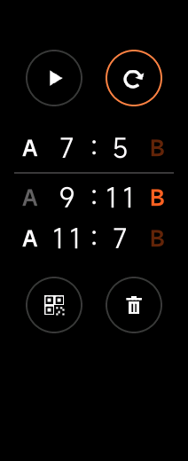
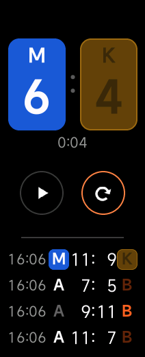
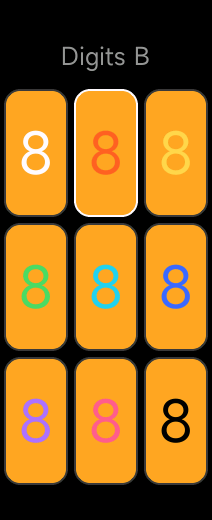
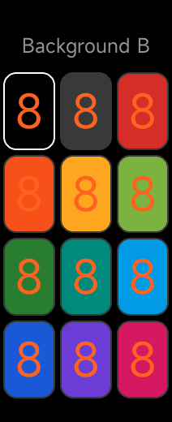
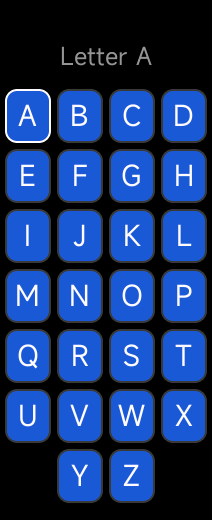

# micounter

[Русская версия](README.ru.md)

A score counter for squash, padel and other games on the Xiaomi Smart Band 10.

<p>
  
  
  
  
</p>
<p>
  
  
  
</p>

The screen is split into two zones: tap a zone to give that player a point. The buttons in the middle undo the last point and finish the game; the number between them is the total of both scores, handy for padel. When the game is finished you see the result and the history of previous games. Long-press a player's digits, letter or background to change their color or letter.

The app follows the band's language: Russian on a Russian-language band, English otherwise.

## Installation

You need an Android phone: the app is installed with Notify for Xiaomi.

1. Download [`release/micounter.rpk`](release/micounter.rpk) (version 1.6.0) to the phone.
2. Install [Notify for Xiaomi](https://play.google.com/store/apps/details?id=com.mc.xiaomi1) from Google Play.
3. Temporarily disable Mi Fitness: in the phone settings, revoke its "Nearby devices" permission and force-stop it. Don't unpair the band in Mi Fitness.
4. Pair the band in Notify. When the setup asks for the Auth Key, tap **Get** and sign in with your Xiaomi account.
5. In Notify, go to the firmware update section, choose **Third party app (rpk)**, select `micounter.rpk` and install it.
6. After installation, give Mi Fitness its "Nearby devices" permission back.

The app appears in the band's app list as **MiCounter**.

## Building

```
npm install
npm run build
```

The `.rpk` is written to `dist/`.

## Screenshots

```
npm run screenshots
```

Runs the latest build from `dist/` in the Vela emulator with the Mi Band 10 screen size (212×520), goes through the main screens and saves screenshots to `screenshots/`. On the first run it downloads the emulator SDK, about 830 MB, to `~/.vela/sdk` (or `VELA_SDK_HOME`). On Linux it needs `libgl1 libx11-6 libxcb1 libxext6 libxfixes3 libxdamage1 libpulse0 libnss3`.
