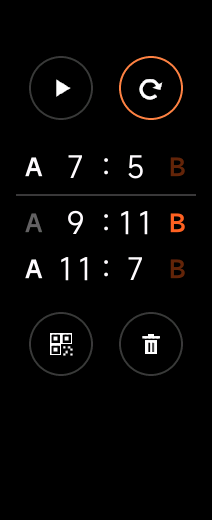
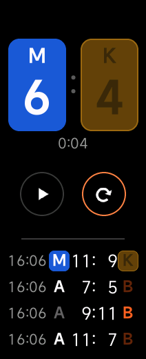
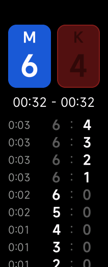
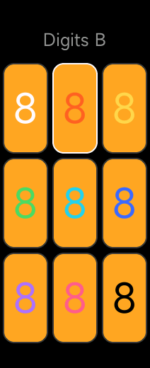
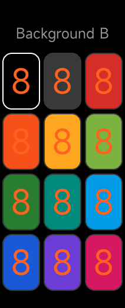
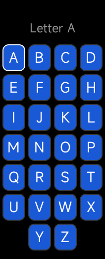

# micounter

[English version](README.md)

Счётчик очков для сквоша, падела и других игр на Xiaomi Smart Band 10.

<p>
  
  
  
  
</p>
<p>
  
  
</p>
<p>
  
  
  
</p>

Экран разделён на две зоны: тап по зоне добавляет игроку очко. Посередине кнопки отмены и завершения игры, между ними — сумма очков обоих игроков (удобно для падела); после завершения игра показывается первой в списке прошлых игр, с кнопками «продолжить» и «новая игра». Тап по игре показывает её длительность и счёт после каждого очка; там же игру можно удалить. Кнопка QR под списком показывает код с последними играми: отсканируйте его телефоном, и они откроются таблицей на [странице истории](https://iliin-ivig.github.io/micounter/). Игры передаются в самой ссылке и ни на какой сервер не отправляются. Долгое нажатие на цифру, букву или фон игрока меняет их цвет и букву.

Язык приложения — как у браслета: русский на русскоязычном браслете, иначе английский. Скриншоты сняты в эмуляторе с английским языком.

## Установка

Нужен Android-телефон: установка идёт через приложение Notify for Xiaomi.

1. Скачайте [`release/micounter.rpk`](release/micounter.rpk) (версия 1.10.0) на телефон.
2. Установите [Notify for Xiaomi](https://play.google.com/store/apps/details?id=com.mc.xiaomi1) из Google Play.
3. Временно отключите Mi Fitness: в настройках телефона заберите у него разрешение «Устройства поблизости» и остановите приложение. Браслет в Mi Fitness не отвязывайте.
4. Подключите браслет в Notify. Когда мастер попросит Auth Key, нажмите **Get** и войдите в аккаунт Xiaomi.
5. В Notify откройте **Устройство → Обновление прошивки → Стороннее приложение**, выберите `micounter.rpk` и нажмите **Установить**.
6. После установки верните Mi Fitness разрешение «Устройства поблизости».

Приложение появится в списке приложений браслета как **MiCounter**.

## Сборка

```
npm install
npm run build
```

Готовый `.rpk` появится в `dist/`.

## Скриншоты

```
npm run screenshots
```

Запускает свежую сборку из `dist/` в эмуляторе Vela с экраном Mi Band 10 (212×520), проходит по основным экранам и сохраняет скриншоты в `screenshots/`. При первом запуске скачивает SDK эмулятора, около 830 МБ, в `~/.vela/sdk` (или в `VELA_SDK_HOME`). На Linux нужны библиотеки `libgl1 libx11-6 libxcb1 libxext6 libxfixes3 libxdamage1 libpulse0 libnss3`.
